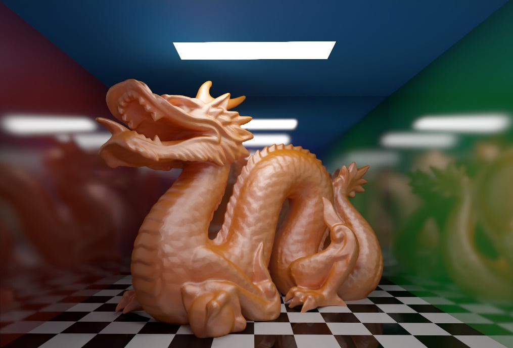

# Custom ray tracing shader

This is my attempt at a custom ray tracing shader, inspired by [Sebastian Lague's ray tracing videos](https://www.youtube.com/watch?v=Qz0KTGYJtUk) and [his project](https://github.com/SebLague/Ray-Tracing).

I use Unity for the scenes and camera, with C++ and CUDA for the renderer. I'm comparing single-core CPU, multicore CPU, CUDA, and Embree, with progressive rendering, BVH traversal, Sobol sampling, and optional OptiX AI denoising.



## Run it

My current setup uses Linux, Unity 6000.3.26f1, CUDA 13, and an NVIDIA GPU with driver R570 or newer.

```sh
./Tools/install_embree.sh
./Tools/install_optix.sh
./Native/build.sh
```

Open `UnityRayTracer` in Unity, open a demo in `Assets/Scenes`, and press Play. Press F1 for the renderer settings.

The dragon model and room are adapted from Sebastian Lague's project. His [MIT license](UnityRayTracer/Assets/RayTracing/Models/Sebastian-Lague-LICENSE.txt) is included with the assets.
